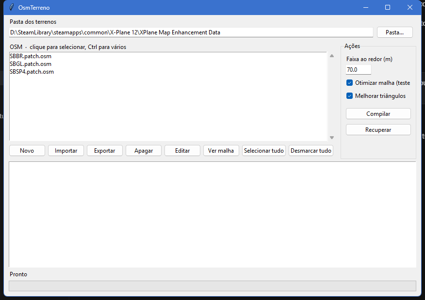

# OsmTerreno

Aplica as altitudes de polígonos OSM na malha do X-Plane Map Enhancement. O aeroporto fica na altura do OSM, com uma faixa suave ao redor, e a água no nível do mar permanece com a malha original.

A janela reúne a lista de OSM, a compilação, a recuperação do backup e o editor. O editor abre numa janela do próprio programa, com mapa, e só grava o arquivo. A compilação fica na janela principal.

## O que precisa

- Windows, Linux ou Mac
- Python 3.12
- 7-Zip no Linux e no Mac. No Windows ele já vem em `ferramentas/win`
- O DSFTool 24-5, já em `ferramentas/win`, `ferramentas/lin` e `ferramentas/mac`

```
py -3.12 -m pip install -r requirements.txt
```

## Abrir

No Windows, dê dois cliques em `OsmTerreno.bat`. No Linux ou no Mac:

```
sh OsmTerreno.sh
```

Na primeira vez, use **Pasta...** e aponte para a pasta do Map Enhancement, a que contém `XPME_South_America`. Esse caminho fica no `config.json`, só nesta máquina.

## Tutorial

1. Coloque os `.patch.osm` em `osm/`, ou use **Importar**. **Novo** cria um arquivo vazio.
2. Clique num OSM para selecionar. Ctrl seleciona vários e Shift seleciona um intervalo. **Selecionar tudo** e **Desmarcar tudo** valem para a lista inteira.
3. **Editar** abre o mapa do OSM selecionado. Desenhe ou ajuste a altitude e salve com Ctrl+S. Compilar não fica nessa janela.
4. **Ver malha** mostra os triângulos do tile na área do OSM. Dá para alternar entre o compilado, o original e as prévias, sem gravar o DSF.
5. Ajuste a **Faixa ao redor**, em metros. **Otimizar malha** junta os triângulos planos. **Melhorar triângulos** reduz ângulos muito fechados. As duas são opcionais.
6. **Compilar** grava o DSF por cima do Map Enhancement. O backup `.antes_osm` é criado uma vez e não é substituído. **Recuperar** devolve esse backup.
7. Reinicie o X-Plane para ver o terreno. O registro da última compilação fica em `logs/Log.txt`.



OSM do mesmo tile compilam juntos, a partir do backup. Um OSM não apaga o corte do outro. Vários tiles seguem um depois do outro.

## O que o corte faz

- Dentro do polígono, a altitude é a do OSM, mesmo abaixo do nível do mar.
- Na faixa ao redor, a altura desce lisa até o terreno.
- A malha no nível do mar, fora dos polígonos, não é reescrita. Isso evita o corte seco na água.
- O ponto na fronteira com um triângulo que não foi cortado fica na altura original, para não abrir fresta.
- O DSF volta compactado em 7z LZMA. LZMA2 faz o X-Plane recusar o arquivo.

O resumo dos manuais do DSFTool e do DDSTool está em `ferramentas/MANUAL.md`.
